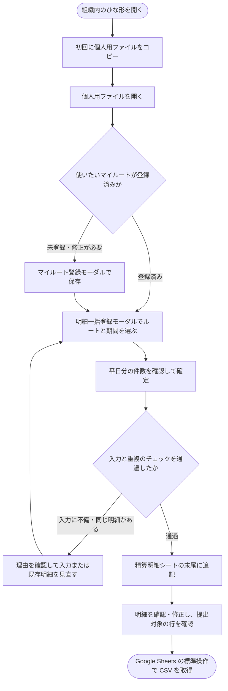

# 交通費精算 CSV — GAS 版 業務フロー

組織内に配布されたひな形から個人用ファイルを作り、必要な期間の交通費明細を CSV として取得する。

## 業務フロー図

## 操作手順

| 手順 | 利用者の操作 | 画面・シートの応答 | 機能ID |
|---|---|---|---|
| 1. 利用開始 | 初回は閲覧用のひな形をコピーする。次回以降は自分のファイルを開く。 | 「交通費精算」メニューが表示される。初回実行時に承認画面が表示された場合は、内容を確認して進める。 | — |
| 2. ルートを用意 | 「マイルート登録」を開き、必要なルートを新規登録または修正する。「金額/Km(片道分)」には片道分を入力する。 | 入力チェック後、`マイルート` シートへ保存する。入力に不備があればフォームに理由を表示する。 | G01 |
| 3. 対象を指定 | 「明細一括登録」を開き、ルートと開始日・終了日を選ぶ。 | 選んだ期間の月曜〜金曜の件数を表示する。開始日・終了日が平日なら対象に含め、平日の祝日も含める。 | G02 |
| 4. 一括登録 | 件数を確認して確定する。 | `精算明細` の末尾へ日付の昇順で追記し、追加件数を表示する。日付は `YYYY-MM-DD`。 | G02 |
| 5. CSV 作成 | `精算明細` を開き、内容と提出対象を確認する。［ファイル］→［ダウンロード］から CSV を選ぶ。 | 確認したシートの明細が CSV として手元に保存される。過去分も残るため、提出範囲は利用者が確認する。 | G03 |

## 分岐と再開

| 状況 | 再開方法 |
|---|---|
| 使えるルートがない | 一括登録モーダルを閉じ、手順2で登録してから開き直す。 |
| 期間が未入力・逆順・1,000日超、または対象の平日が0件 | モーダルのメッセージを確認し、手順3で期間を修正する。 |
| 入力中に選択したルートが変更された | 一括登録モーダルを開き直し、最新のルートを選ぶ。 |
| 既存の明細と9列すべてが一致する | GAS は追加せず、該当日を表示する。既存の明細または指定期間を見直してから再実行する。 |
| シートや見出しが見つからない | 表示されたシート名や見出しをひな形と照合する。構成を戻してから再実行する。 |

業務フローの完了は CSV のダウンロード。提出先システムへのアップロードや承認は、このファイルの外で行う。

- [機能一覧](機能一覧.md)
- [基本設計](基本設計.md)
