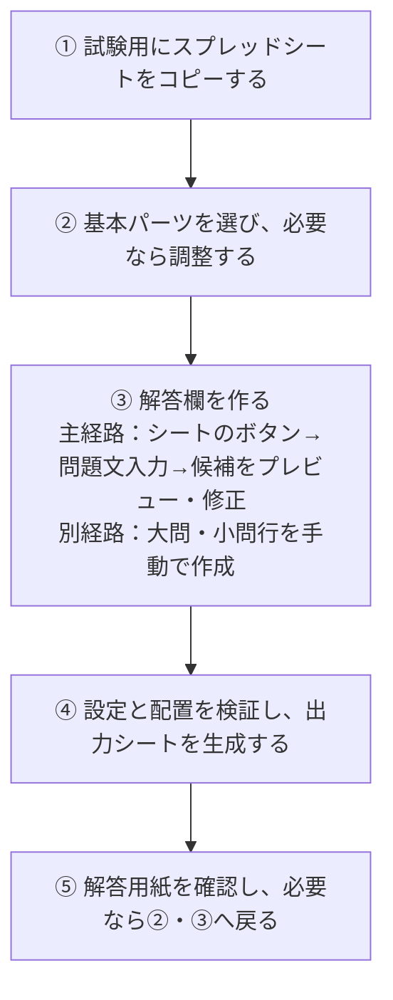

# 解答用紙GAS 基本設計

| 項目 | 内容 |
| --- | --- |
| 対象 | `create-answer-paper-gas` のスプレッドシート用Apps Script |
| 対象画面 | Googleスプレッドシートの操作ボタン、問題文入力ダイアログ、設定シート、パーツ編集サイドバー |
| 設計の位置づけ | 目指す運用を主文とする。現行実装との差は第7章に記載 |
| 実装の確認時点 | 2026-11-17 時点の `create-answer-paper-gas/src/` |
| 想定読者 | 開発・保守担当者 |

## 1. 目的と対象範囲

定期考査の**B4横想定の解答用紙**を、設問の構造に合う解答欄パターンと基本パーツから組み立て、「出力」シートで確認できるようにする。複雑な小問や解答欄を毎回一から配置する手間を減らすことが目的である。

主経路は、問題文を貼り付け、行頭の大問・小問番号と本文中の括弧・英字・丸数字などを解析し、解答欄の形と枠数を**候補として表示**する。利用者が候補を確認・修正してから設定に登録する。問題文を使わずに大問・小問行・基本パーツを手動で作る経路も同じ出力へつなぐ。プリセットはよく使う形の再利用に用いる。

試験ごとにスプレッドシート全体をコピーして使い、設定と出力をそのファイルに残す。自動で増える履歴シートは目標運用に含めない。用紙の寸法と出力グリッドは現行のB4横想定の設定を維持する。

## 2. システム構成と利用の流れ

Apps ScriptのV8ランタイムで動作する。スプレッドシート上の操作ボタン、HTML Serviceの問題文入力ダイアログと編集サイドバーから操作し、確定した大問・小問行・基本パーツとプリセット、生成結果を同じスプレッドシートに保持する。問題文から得た解析候補は、利用者が確定するまでは設定表へ反映しない。

### 2.1 業務フロー

上から下へ進む。③では問題文から作る方法と手動で作る方法のどちらかを選び、必要に応じて併用する。

### 2.2 各工程の具体的な手順

1. **試験用のファイルを用意する**
   - 解答用紙のひな形となるスプレッドシート全体をコピーし、試験ごとのファイル名を付ける。「設定」「基本パーツ」「パーツプリセット」の関係をコピー内に保つ。
   - ひな形の入力表は保守担当者が用意する。`setupSheets()` は保守用に残すが、利用者の操作ボタンには出さない。「設定」「基本パーツ」「出力」のいずれかが既にあれば中止し、既存ファイルを初期化しない。既存のひな形にはコード反映後に `installActionButtons()` を一度実行してボタンを配置する。
2. **基本パーツを設定する**
   - 考査見出し、年組氏名欄、得点枠から必要なものを選び、「基本パーツ」シートで使用、順番、表示文字、寸法を確認・調整する。
   - よく使う設定はプリセットから選び、対象行を選択して「基本パーツ」シートのボタンで適用する。プリセットを使わずに手入力してもよい。
3. **解答欄を作る**
   - **主経路：**シート上の「問題文を解析」ボタンから入力画面を開き、問題文を貼り付けて解析する。大問・小問の区切り、解答欄のラベルと枠数、判定根拠を確認する。解答欄の形をプレビューで見ながら候補を直し、確定後に「設定」の大問表・小問行表へ登録する。
   - **別経路：**問題文を入力せず、「設定」シートまたは編集パネルで大問・小問行を作る。必要ならプリセットを起点に内容を変更する。
   - 1枚の解答用紙で両経路を併用できる。解析が曖昧な箇所は利用者が最終判断する。
4. **出力を生成する**
   - 「設定」シートの「出力を更新」ボタンを押す。使用中のパーツ、大問と小問の対応、解答欄の幅・枠数、左右領域への収まりを検証し、「出力」シートを更新する。
   - エラーがあれば設定を直して再実行する。確定前の解析候補は出力に反映しない。
5. **解答用紙を確認する**
   - 「出力」シートでパーツの順番、設問と解答欄の対応、枠の数・幅・配置を確認する。パーツ編集は用紙範囲外のボタンから開く。意図と違う場合は②または③に戻って調整する。

## 3. 画面設計

### 3.1 画面構成

| 領域 | 主な役割 |
| --- | --- |
| 「設定」シートのボタン | 出力更新、プリセット欄の追加・更新、選択行へのプリセット適用。将来の「問題文を解析」の入口もここに設ける |
| 「基本パーツ」シートのボタン | 選択行へのプリセット適用 |
| 「出力」シートのボタン | 用紙範囲外からパーツ編集パネルを開く |
| 問題文入力ダイアログ | 問題文の入力、解析候補の修正、解答欄プレビュー、登録の確定を一つの画面で行う |
| 「基本パーツ」シート | 考査見出し、年組氏名欄、得点枠の使用・順番・文字・寸法を入力 |
| 「設定」シート | 大問表と小問行表を入力。大問番号で親子を対応付ける |
| 「出力」シート | 検証済みのパーツをB4横想定の左右2領域に描画 |
| 「パーツプリセット」シート | 保存した基本パーツ・大問と、大問に属する小問行を保持 |
| 作成サイドバー | 手動での作成・編集とプリセット利用へ進める。問題文からの作成はシート上のボタンから直接開ける |

既存メニューの利用者向け項目はボタンへ移す。「設定」のボタンは大問・小問の入力欄より上、「基本パーツ」の適用ボタンは入力表より下に置く。どのボタンも押下時に操作名と「実行しますか？」を表示し、「はい」の場合だけ処理を実行する。適用時は対象行を選択してからボタンを押す。`installActionButtons()` は同じボタンを重複作成せず、既存ボタンを再利用する。

問題文入力ダイアログは、入力欄の下に解析候補と解答欄プレビューを表示する。プレビューには大問・小問の順番、解答欄パターン、枠数、ラベル、枠ごとの幅比を出力に近い形で示し、判定根拠と「要確認」の状態も併記する。候補を修正するとプレビューを更新し、利用者が確定するまでは設定表と「出力」シートを変更しない。確定時に設定へ登録して出力を更新する。手動作成画面からは使用中のパーツの編集に加え、問題文を使わない作成方法へ進める。履歴タブは置かない。

### 3.2 用紙・表示条件

| 項目 | 現行仕様 |
| --- | --- |
| 出力グリッド | 72列×51行。列幅・行高は各19px |
| 左右の配置領域 | 左は3列目、右は39列目から。各領域は33列幅、3行目から下へ配置 |
| 使用可能な高さ | 各領域49行。1つのパーツや大問は左右に分割しない |
| 基本パーツの入力枠 | 「基本パーツ」シートの4〜13行、最大10件 |
| 大問の入力枠 | 「設定」シートの21〜60行、最大40件 |
| 小問行の入力枠 | 「設定」シートの6〜155行、最大150件 |
| 出力の用紙想定 | 現行のB4横想定のグリッドを維持 |

パーツは「使用」にチェックがある行だけを対象とし、基本パーツと大問に共通の「順番」で並べる。同じ順番の場合は元のシート行に基づいて並べる。左上から積み上げ、次のパーツが左領域に収まらなければ右上へ送る。大問の見出しと小問行は一体として扱い、途中で分割しない。

「出力」シートの操作ボタンは用紙範囲 `A1:BT51` の右側に置く。印刷・PDF化では `A1:BT51` を選択してB4横・1ページで出力し、操作ボタンを含めない。

## 4. 機能設計

| ID | 機能 | 目標とする入力・操作 | 結果 |
| --- | --- | --- | --- |
| G-01 | 問題文から解答欄候補を作成 | シート上のボタンで入力画面を開き、問題文を解析。設問の区切り、ラベル、枠数、パターンの候補と解答欄の形を表示 | 利用者がプレビューを確認・修正して確定した大問と小問行を設定へ登録する |
| G-02 | 手動で作成 | 問題文を使わず基本パーツ・大問・小問行を入力 | 解析経路と同じ設定表へ登録し、出力対象にする |
| G-03 | パーツ編集・操作 | 使用中のパーツを選び、内容変更、順番変更、複製、削除 | 設定を更新し、出力を再生成する |
| G-04 | プリセット再利用 | 基本パーツまたは大問の保存済み設定を内容確認後に選ぶ | 対象行に適用して必要な箇所だけ調整できる |
| G-05 | 出力を更新 | 確定済みの設定から生成を実行 | 入力・配置を検証し、B4横想定の「出力」シートを描画する |
| G-06 | 試験ごとのファイル管理 | ひな形のスプレッドシートをコピーする | 設定と出力を試験ごとのファイルに残し、履歴シートを増やさない |

### 4.1 大問・小問行と問題文解析

大問は番号、順番、観点、配点、幅、後の空き、および任意の題名を持つ。小問行は対象大問番号、行番号、左端の表示番号、ラベル、幅比、高さ、解答欄パターン、枠数などを持つ。パターンは「小問複合枠」または「記述欄」。未指定時はラベルの有無から決める。小問複合枠ではラベルごとの幅比で解答欄を分け、記述欄では指定した枠数へ等分する。

問題文解析は、記号の**位置と役割**を区別する。たとえば行頭の「大問2」「【大問 2】」は大問、行頭の枝番や `(1)`、`問1` は小問の境界、本文中の `①〜④` や `(A)(B)` は解答欄ラベルの候補となる。連続記号や「2つ答えよ」のような表現から枠数を推定する。候補には根拠と「要確認」を示す。プレビューは大問・小問ごとの解答欄を枠線で描き、ラベル・枠数・相対的な幅と並びを確認できるようにする。これは登録前の候補表示であり、B4用紙全体の完成表示は確定後の「出力」シートで確認する。曖昧な判定は利用者が確定し、既存大問を置き換える際は確認を求める。

問題文を使わない場合も、大問・小問行を直接入力して同じ「設定」シートに保存する。基本パーツの手動入力も可能とする。両経路で作ったパーツは同じ用紙内で組み合わせられる。

### 4.2 編集・プリセット

サイドバーの一覧は使用中の基本パーツと大問を表示する。基本パーツは順番・表示文字・幅・高さ・後の空きを編集できる。大問は番号・題名・観点・配点・幅・後の空きと小問行をまとめて編集できる。複製時は次の順番を設定し、大問には重複しないコピー番号と小問行の複製を作る。削除時は使用をオフにし、大問に属する小問行を消す。

プリセットは基本パーツまたは大問とその小問行を名前付きで保存する。利用者は適用前に種類と内容を確認し、対象を選んで反映する。適用後の個別調整と、プリセットを使わない手動入力の両方を認める。履歴の代わりに試験ごとのスプレッドシートをコピーして残す。

## 5. データと状態

| データ | 内容・保持場所 |
| --- | --- |
| 基本パーツ表 | 「基本パーツ」A:G列。使用、順番、種類、表示文字、幅、高さ、後の空き |
| 大問表 | 「設定」A:G列の21〜60行。使用、順番、番号、観点、配点、幅、後の空き。I列に題名 |
| 小問行表 | 「設定」J:U列の6〜155行。対象番号、行番号、ラベル、幅比、高さ、パターン、枠数、解析根拠など |
| プリセット | 「パーツプリセット」A:J列に親データ、L:W列に大問の小問行。IDで対応付ける |
| 解析候補 | 問題文から推定した大問・小問・枠数・根拠。確認中は入力ダイアログ側に一時保持し、確定後に設定表へ登録 |
| 出力 | 「出力」シートの結合セル、罫線、文字、用紙グリッド |
| 画面の一時状態 | 選択中のパーツと編集中の小問行をサイドバー側に、問題文の解析候補とプレビューを入力ダイアログ側に保持 |

設定と生成結果は試験ごとのスプレッドシートに残す。初回セットアップは新しい履歴シートを作らず、既存の履歴シートも削除しない。大問の題名、グループ経路、記入項目数、判定根拠など一部の項目は管理・照合用であり、現行の出力シートの文字や枠の描画には使われない。

## 6. 出力設計

| 出力 | 内容 | 特性 |
| --- | --- | --- |
| 「出力」シート | 基本パーツと大問・小問行を左右2領域へ配置 | 現行のB4横想定のグリッド、セル結合、罫線、文字で構成。更新時は既存の出力シートを初期化して再描画する |

出力には、問題文から確定した設定と手動で作成した設定の両方を使う。出力前に入力値と配置を計算し、基本パーツまたは大問が左右の領域に収まらない場合は更新を中止する。入力・配置検証が通ってから「出力」を消して再描画する。描画途中にエラーが起きた場合の旧出力シートへの自動復元は現行実装にない。

## 7. 現行実装との差異と制約

| 項目        | 現行実装                                              | 目標・扱い                     | チケット                                                |
| --------- | ------------------------------------------------- | ------------------------- | --------------------------------------------------- |
| 解析の判定精度   | 記号・行頭位置・文章の一部表現をルールで解析。網羅的な期待例と自動検証はない            | 実際の問題文と期待する枠を対にして判定を検証する  | [T-01](改善チケット案.md#t-01-問題文解析の判定例と検証ケース)             |
| 候補の確認     | 大問・小問・枠数・根拠をサイドバーの文字と入力欄で確認。シート上の解析ボタン、入力ダイアログ、解答欄の図によるプレビューはない | ボタンから問題文を入力し、登録前に枠の形・数・ラベル・幅を確認・修正する | [T-02](改善チケット案.md#t-02-解析候補の確認画面)                   |
| 作成経路の案内   | サイドバーの初期タブはパーツ編集。問題文から追加は別タブ。手動入力は設定シートでも可能       | 問題文解析を主経路にし、手動作成も見つけやすくする | [T-03](改善チケット案.md#t-03-二つの作成経路を分かりやすくする)            |
| 履歴とファイル管理 | 初回セットアップは既存シートがあると中止。履歴生成・復元UIはなく、既存の履歴シートはそのまま残る | 試験ごとのファイルコピーを使う           | [T-04 実装済み・実機検証済み](改善チケット案.md#t-04-履歴機能を使わない運用への移行) |
| プリセット選択   | 保存はサイドバー、適用は対象行のH列で選択してメニューから実行                   | 内容を確認して適用できる操作へ改善する       | [T-05](改善チケット案.md#t-05-プリセットの選択操作を改善する)             |
| 用紙・入力枠    | B4横想定の72列×51行。基本パーツ10件、大問40件、小問行150件              | 現行の寸法・入力枠を維持する            | —                                                   |

この章は設計と実装を混同しないための差分表である。チケットが完了するまでは「目標」の記述を現行機能として案内しない。

## 8. 参照資料・実装

- [改善チケット案](改善チケット案.md) — 第7章の差分に対応する実装候補
- [メニュー・シート作成・出力生成](../../../../create-answer-paper-gas/src/AnswerSheetGenerator.js) — 設定、検証、配置、描画、サイドバー連携
- [シート上の操作ボタン](../../../../create-answer-paper-gas/src/ActionButtons.js) — ボタンの配置と実行関数の割り当て
- [サイドバー](../../../../create-answer-paper-gas/src/PartEditor.html) — 現行の編集・問題文追加タブ、解析結果の文字による確認、GAS呼び出し
- [問題文解析](../../../../create-answer-paper-gas/src/DocumentAnalysis.js) — 文書全体の解析と大問一括登録
- [プリセット](../../../../create-answer-paper-gas/src/Presets.js) — 再利用機能
- [Apps Script設定](../../../../create-answer-paper-gas/src/appsscript.json) — V8ランタイム、タイムゾーン
