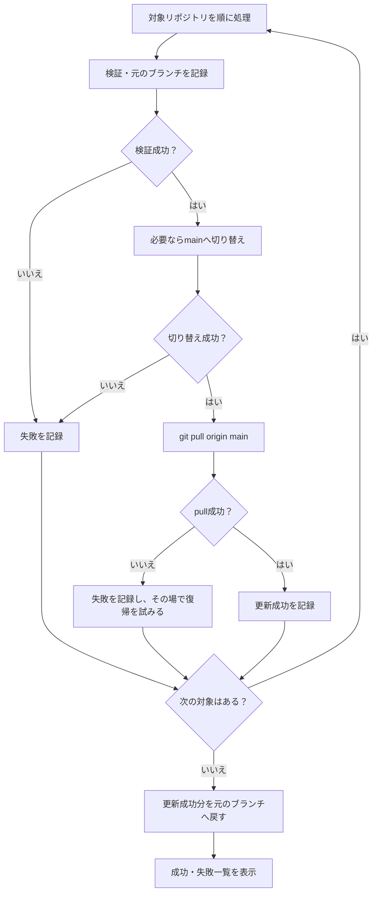

# **複数リポジトリのmain更新スクリプト設計書**

## **1\. 概要**

### **1.1 スクリプトの目的**

同じ階層にある複数のリポジトリのmainブランチの最新化の自動化

### **1.2 背景**

製造やテストの工程に進むにつれてローカルの最新化を頻繁に行うことが増えてくる。
手動で一つずつ実行するのは手間であり、最新化忘れを引き起こす可能性もある。
複数リポジトリでブランチの確認・切り替え・`pull`を手動で繰り返す手間を減らしたい。

## **2\. 実行環境・前提条件**

### **2.1 対象OSおよび対象シェル**

* 対象OS：macOS、Linux  
* 対象シェル：Bash  
* ファイル形式：`.sh`

スクリプトと対象リポジトリは、同じ親ディレクトリの直下に配置する。

workspace/  
├── update-main.sh  
├── backend/  
├── frontend/  
└── command/

対象を探す基準はスクリプトの配置場所とし、コマンドを実行したときの作業ディレクトリには依存しない。

###  

###   **2.2 依存する外部コマンド・パッケージ**

`bash`と`git`を使用する。各対象リポジトリには、ローカルの`main`ブランチと  
`origin`リモートが必要となる。

## **3\. インターフェース設計**

### **3.1 コマンド書式**

```
update-main.sh
```


## **4\. 入出力設計**

### **4.1 入力**

* スクリプト内の対象リポジトリ一覧
      象リポジトリのディレクトリ名をスクリプト内であらかじめ指定し、その順番で処理する。

```
TARGET_REPOS=("backend" "frontend" "command")
```

* 各リポジトリの現在のブランチ  
* 各リポジトリのGit設定と作業状態

各リポジトリの処理を始める際に、元のブランチ名を記録する。

### **4.2 出力**

処理中は、対象リポジトリと実行中の操作をターミナルへ表示する。全対象の処理が終わったら、成功・失敗の件数と一覧を表示する。

失敗したリポジトリについては、**失敗した操作、元のブランチへ復帰できたか、終了時のブランチ**を示す。

```
成功（2件）
  backend   pull成功／feature/EU022へ復帰成功
  command   pull成功／実行開始時からmain

失敗（2件）
  frontend  pull失敗／feature/EU023へ復帰成功
  docker    pull失敗／復帰失敗／終了時のブランチ: main
```

### **4.3 終了コード**

| 終了コード | 意味 |
| :---- | :---- |
| `0` | 全対象で`pull`と必要なブランチ復帰に成功 |
| `1` | 1件以上の失敗、または対象一覧が空 |

元のブランチへの復帰に成功しても、`pull`に失敗したリポジトリの結果は「失敗」とする。

## 

## **5\. 処理ロジック・フロー設計**

### **5.1 全体処理フロー**



### **5.2 各処理ステップの詳細**

**① 対象一覧の確認**

対象一覧が空なら、その旨を表示して終了する。それ以外は指定された順番で処理する。

**② リポジトリごとの確認**

対象ディレクトリが存在し、Gitリポジトリであることを確認する。現在のブランチ名、ローカルの`main`ブランチ、`origin`リモートも確認する。

確認できない項目があれば、そのリポジトリを失敗として記録し、次へ進む。detached HEADなど、元のブランチ名を記録できない状態も失敗とする。

**未コミット変更の有無は事前の失敗条件にしない。** 自動`stash`や変更の破棄も行わない。

**③ 元のブランチを記録して`main`へ切り替え**

実行開始時のブランチが`main`なら切り替えない。作業ブランチなら、その名前を記録してローカルの`main`へ切り替える。

未コミット変更などの影響で切り替えに失敗した場合は、失敗を記録して次のリポジトリへ進む。

**④ `main`を更新**

`main`上で次を実行する。

```
git pull origin main
```

Gitの設定に応じた動作を含め、コマンドの終了結果で成功・失敗を判定する。

**⑤ `pull`失敗時の復帰**

`pull`が失敗したら、その原因を記録する。実行開始時に作業ブランチにいた場合は、  
**その場で**元のブランチへの切り替えを試みる。復帰の成否を記録してから、  
次のリポジトリへ進む。

実行開始時から`main`だった場合は、ブランチ切り替えを行わず次へ進む。

**⑥ `pull`成功時の復帰**

`pull`が成功したリポジトリのうち、実行開始時に作業ブランチにいたものは、**全対象の更新処理が終わった後**に元のブランチへ戻す。

復帰に失敗した場合、そのリポジトリの最終結果を「失敗」とする。

## **6\. エラーハンドリング・例外処理**

### **6.1 入力バリデーション**

対象一覧が空の場合は、スクリプト全体を終了する。

対象ディレクトリの不在、Gitリポジトリではない、`main`や`origin`がない、といった問題は対象ごとに記録し、残りの処理を続ける。未コミット変更があるという理由だけでは処理を止めない。

### **6.2 実行時エラー**

| 失敗した操作 | そのリポジトリで行うこと |
| :---- | :---- |
| `main`への切り替え | 失敗を記録し、次へ進む |
| `git pull origin main` | 失敗を記録し、元の作業ブランチへの復帰を試みてから次へ進む |
| 元のブランチへの復帰 | 復帰失敗と終了時のブランチを記録し、次へ進む |

復帰時にGitが切り替えを拒否した場合、強制的な切り替えや変更の破棄は行わない。そのリポジトリの現在の状態を残し、結果一覧で知らせる。


### **6.3 割り込み・クリーンアップ処理**

Ctrl+Cなどで中断された場合は、新たなリポジトリの更新を始めない。元のブランチ名を記録済みで、復帰が必要なリポジトリについて復帰を試みる。その後、処理済み・失敗・未処理の対象を表示して終了する。

復帰できない状態では強制操作をせず、終了時のブランチを表示する。


## **7\. ログ設計**

### **7.1 ログの出力先**

初版ではターミナルに出力する。ログファイルへの保存は行わない。

### **7.2 ログレベルとフォーマット**

通常の進行には`INFO`、失敗には`ERROR`を使用し、リポジトリ名を付ける。

```
[INFO]  [backend] mainへ切り替え
[INFO]  [backend] pull成功
[ERROR] [frontend] pull失敗
[INFO]  [frontend] feature/EU023へ復帰成功
```

最後の結果一覧では、途中のログを読み返さなくても状況が分かるように、更新と復帰の結果をそれぞれ表示する。

```
更新が成功したブランチ一覧XXXXXXXX
XXXXXXXX
更新が失敗したブランチ一覧
〇〇〇〇

作業ブランチに移動したブランチ一覧(mainを取り込む場合は手動でmargeしてください)
△△△△△△△△△△△△
```

