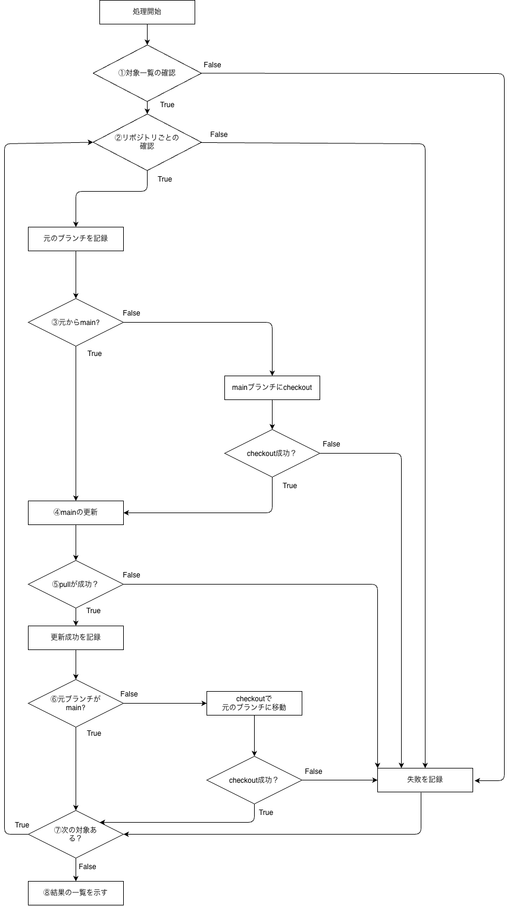

# **複数リポジトリのmain更新スクリプト設計書**

## **1\. 概要**

### **1.1 スクリプトの目的**

同じ階層にある複数のリポジトリのmainブランチの最新化の自動化

### **1.2 背景**

製造やテストの工程に進むにつれてローカルの最新化を頻繁に行うことが増えてくる。
手動で一つずつ実行するのは手間であり、最新化忘れを引き起こす可能性もある。
複数リポジトリでブランチの確認・切り替え・`pull`を手動で繰り返す手間を減らしたい。

## **2\. 実行環境・前提条件**

### **2.1 対象OSおよび対象シェル**

* 対象OS：macOS、Linux  
* 対象シェル：Bash  
* ファイル形式：`.sh`

スクリプトと対象の Git リポジトリは、同じ親ディレクトリの直下に配置する。配列には各リポジトリのルートディレクトリ名を指定する。

workspace/  
├── update-main.sh  
├── backend/  
├── frontend/  
└── common/

対象を探す基準はスクリプトの配置場所とし、コマンドを実行したときの作業ディレクトリには依存しない。

###  

###   **2.2 依存する外部コマンド・パッケージ**

`bash`と`git`を使用する。各対象リポジトリには、ローカルの`main`ブランチと  
`origin`リモートが必要となる。

## **3\. 入出力設計**

### **3.1 入力**

* スクリプト内の対象リポジトリのルートディレクトリ名一覧

  対象のディレクトリ名をスクリプト内であらかじめ指定し、その順番で処理する。

```
TARGET_REPO_DIR_NAMES=("backend" "frontend" "common")
```

* 各リポジトリの現在のブランチ  
* 各リポジトリのGit設定と作業状態

各リポジトリの処理を始める際に、元のブランチ名を記録する。

### **3.2 出力**

処理中は、対象リポジトリと実行中の操作をターミナルへ表示する。全対象の処理が終わったら、成功・失敗の件数と一覧を表示する。

失敗したリポジトリについては、**失敗した操作、元のブランチへの復帰状況、終了時のブランチ**を示す。

```
成功（2件）
  backend   pull成功／feature/sample-backendへ復帰成功
  common   pull成功／実行開始時からmain

失敗（1件）
  frontend  pull失敗／復帰せず／終了時のブランチ: main
```

### **3.3 終了コード**

| 終了コード | 意味 |
| :---- | :---- |
| `0` | 全対象で`pull`と必要なブランチ復帰に成功 |
| `1` | 1件以上の失敗、または対象一覧が空 |

`pull`に失敗したリポジトリの結果は「失敗」とし、通常処理では元のブランチに復帰しない。


## **4\. 処理ロジック・フロー設計**

### **4.1 全体処理フロー**



### **4.2 各処理ステップの詳細**

**① 対象一覧の確認**

- (1) 対象のリポジトリがない → メッセージを表示して終了
- (2) 対象のリポジトリがある → リスト順に実行

**② リポジトリごとの確認**

- (1) ディレクトリ、`.git`、Gitルート、`main`、`origin`、変更の有無を確認した後、現在のブランチを記録
- (2) 確認できない項目がある → 失敗を記録して次の対象へ
- (3) ステージ済み・未ステージの変更がある → 失敗を記録して次の対象へ
- (4) 未追跡ファイルだけがある → 処理を続行。`stash`や変更の破棄はしない

**③ `main`への切り替え**

- (1) 元から`main` → 切り替えずに④へ
- (2) 作業ブランチ → 記録した元のブランチ名を保持し、`main`へ切り替え
- (3) 切り替えに失敗 → 失敗を記録して次の対象へ

**④ `main`の更新**

- `git pull origin main`を実行

**⑤ `pull`の成否判定**

- (1) 成功 → 更新成功を記録して⑥へ
- (2) 失敗 → 失敗時のブランチを記録し、復帰せず⑦へ

**⑥ 元のブランチへの復帰**

- (1) 元から`main` → 切り替えずに⑦へ
- (2) 作業ブランチから切り替えた → 元のブランチへ戻して⑦へ
- (3) 復帰に失敗 → その対象を失敗として記録

**⑦ 次の対象の確認**

- (1) 次の対象がある → ②へ
- (2) 次の対象がない → ⑧へ

**⑧ 結果一覧の表示**

- 成功・失敗の一覧を表示し、全対象が成功なら終了コード`0`、失敗があれば`1`で終了

## **5\. エラーハンドリング・例外処理**

### **5.1 入力バリデーション**

対象一覧に対象リポジトリが無い場合は、スクリプト全体を終了する。

Gitリポジトリではない、`main`や`origin`がない、ステージ済み・未ステージの変更がある、といった問題は対象ごとに記録し、残りの処理を続ける。未追跡ファイルだけでは事前に失敗としない。

### **5.2 実行時エラー**

| 操作                     | エラー時の挙動                  |
| :--------------------- | :----------------------- |
| `main`への切り替え           | 失敗と終了時のブランチを記録し、復帰せず次へ進む |
| `git pull origin main` | 失敗と終了時のブランチを記録し、復帰せず次へ進む |
| 元のブランチへの復帰             | 復帰失敗と終了時のブランチを記録し、次へ進む   |

復帰時にGitが切り替えを拒否した場合、強制的な切り替えや変更の破棄は行わない。そのリポジトリの現在の状態を残し、結果一覧で知らせる。

### **5.3 割り込み・クリーンアップ処理**

Ctrl+Cなどで中断された場合は、新たなリポジトリの更新を始めない。元のブランチ名を記録済みで、復帰が必要なリポジトリについて復帰を試みる。その後、処理済み・失敗・未処理の対象を表示して終了する。

失敗時のブランチは記録して一覧に表示する。割り込み時に復帰を試みた場合は、復帰後のブランチで記録を更新する。取得できない場合はその旨を表示する。

復帰できない状態では強制操作をせず、終了時のブランチを表示する。

## **6\. ログ設計**

### **6.1 ログの出力先**

初版ではターミナルに出力する。ログファイルへの保存は行わない。

### **6.2 ログレベルとフォーマット**

通常の進行には`INFO`、失敗には`ERROR`を使用し、リポジトリ名を付ける。

```
[INFO]  [backend] mainへ切り替え
[INFO]  [backend] pull成功
[INFO]  [backend] feature/sample-backendへ復帰成功
[ERROR] [frontend] pull失敗
```

最後の結果一覧では、途中のログを読み返さなくても状況が分かるように、更新と復帰の結果をそれぞれ表示する。

```
更新が成功したブランチ一覧XXXXXXXX
XXXXXXXX
更新が失敗したブランチ一覧
〇〇〇〇

作業ブランチに移動したブランチ一覧(mainを取り込む場合は手動でmargeしてください)
△△△△△△△△△△△△
```

