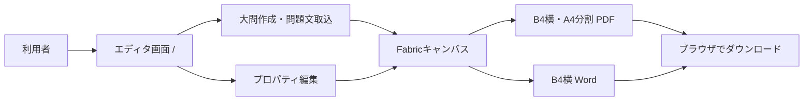

# 解答用紙エディタ 基本設計

| 項目 | 内容 |
| --- | --- |
| 対象 | `create-answer-paper-app` の解答用紙キャンバスエディタ |
| 対象画面 | `/` |
| 設計の基準 | 2026-11-17 時点の現行実装 |
| 想定読者 | 開発・保守担当者 |

## 1. 目的と対象範囲

定期考査の解答用紙をブラウザ上で組み立て、PDFまたはWord文書としてダウンロードする。利用者はB4横の用紙に大問と基本パーツを配置し、内容と位置を調整する。

本書は解答用紙エディタのみを対象とする。別画面 `/preview` のCSV取込・問題用紙生成は対象外であり、両画面間の問題データやレイアウトの受け渡しは実装されていない。保存・読込機能、サーバーへの送信、アカウント管理も現行機能にはない。

## 2. システム構成と利用の流れ

Next.js App Routerの `/` からクライアント側でエディタを読み込む。Reactが画面・設定パネル・モーダルを管理し、Fabric.jsが用紙上のブロックを描画・選択・移動する。PDF出力にはpdf-lib、Word出力にはdocxを使用する。

基本的な操作順は、①画面を開く、②大問または基本パーツを追加する、③キャンバスで配置・選択して内容を編集する、④用紙を確認してPDFまたはWordに出力する、である。画面を開いた直後は考査見出し枠が1つ配置される。編集中の配置はブラウザのメモリに保持され、再読み込みすると初期状態に戻る。

## 3. 画面設計

### 3.1 画面構成

| 領域 | 主な役割 |
| --- | --- |
| ヘッダー | エディタ名、観点記号の一括置換、白紙化、PDF・Word出力 |
| ツールバー | 大問・基本パーツの追加、選択ブロックの操作、表示設定、余白、ズーム |
| 用紙キャンバス | B4横の解答用紙を表示し、ブロックの選択・移動を行う |
| 右側プロパティパネル | 選択した大問または基本パーツの設定を編集する |
| モーダル | 大問の新規作成、問題文からの自動取込、観点記号の一括置換 |
| 通知 | 操作結果と出力中・出力失敗を画面右下の短いメッセージで知らせる |

プロパティパネルは編集可能なブロックを選択すると開く。新規大問作成モーダルには作成内容のプレビューがある。既存ブロックの編集は右側プロパティパネルから行う。

### 3.2 用紙・表示条件

| 項目 | 現行仕様 |
| --- | --- |
| 編集用紙 | B4横、364×257mm、キャンバス座標1376×972px |
| 方眼 | 5mm間隔、25mmごとに太線。初期表示はオフ |
| グリッド吸着 | 移動時に5mm相当の位置へ吸着。初期状態はオン |
| 配置ガイド | 他ブロック、用紙余白、折り目などへの整列補助。初期状態はオン |
| 余白ガイド | 上下・外側・中央折り目の配置目安。初期表示はオン |
| 余白の初期値 | 上下10mm、外側10mm、折り目5mm |
| 余白の設定範囲 | 上下5〜25mm、外側5〜20mm、折り目5〜20mm |
| ズーム | 拡大・縮小・画面に合わせる。操作上の範囲は35〜150% |

方眼と余白ガイドは画面上の編集補助である。配置ガイドも出力対象から除外する。余白設定はガイド位置と配置時の整列基準に使い、ブロックを自動的に再配置する機能ではない。

## 4. 機能設計

| ID | 機能 | 入力・操作 | 結果 |
| --- | --- | --- | --- |
| E-01 | 大問の新規作成 | 大問番号、観点区分、配点、横幅、小問グループを設定 | プレビュー確認後、キャンバスに大問を追加して選択する |
| E-02 | 問題文からの自動取込 | 問題文を貼り付け、大問番号と抽出結果を確認 | 小問記号をもとに大問設定を作り、キャンバスに追加する |
| E-03 | 基本パーツの追加 | 考査見出し枠、年組氏名欄、観点別得点枠を選択 | 既定の内容と位置でパーツを追加する |
| E-04 | 既存ブロックの編集 | ブロックを選択し、右側パネルで設定を変更 | 元の配置座標を保ち、変更後の設定で描画し直す |
| E-05 | 配置調整 | ブロックをドラッグし、表示・吸着・余白・ズームを設定 | キャンバス上の位置と編集補助表示を更新する |
| E-06 | ブロック操作 | 選択して複製・削除、または白紙化 | 複製は少しずらして追加。削除は選択対象、白紙化は全要素を削除する |
| E-07 | 観点記号の一括置換 | 検索文字列と置換後文字列を入力 | 配置済みの大問の観点区分に一致する文字列を置換する |
| E-08 | ファイル出力 | B4横PDF、A4分割PDF、Wordを選択 | ブラウザでファイルをダウンロードする |

### 4.1 大問と取込の仕様

大問は大問番号・観点区分・配点・横幅と、複数の小問グループで構成する。新規作成では主に「小問複合枠」と「記述欄」を設定できる。小問複合枠には行ごとのラベルや列数、記述欄には通常の記述欄またはマス目方式を設定できる。大問の横幅は200〜1200pxに制限され、標準値は630pxである。

問題文取込は、行頭の `(1)` のような小問番号を大問直下のグループとして検出し、各範囲内の括弧記号や丸数字などを候補として抽出する。重複した記号は1回にまとめ、抽出後の小問構成を利用者が調整できる。大問直下の小問番号が検出されない場合は追加せず、警告を表示する。CSVファイルをこの取込画面へ読み込む機能ではない。

既存大問では、プロパティパネルから内容・サイズ・解答欄パターンを変更できる。旧形式の等分割グリッド、丸数字区分、左右2分割などの設定も編集対象として残っている。

### 4.2 選択・削除・白紙化

編集可能なブロックは大問、考査見出し、年組氏名欄、観点別得点枠である。選択したブロックはボタンまたはDelete／Backspaceキーで削除できる。ただし入力欄にフォーカスがある間、キー操作による削除は行わない。「白紙に戻す」は確認ダイアログに同意した場合だけ実行する。複製したブロックには元の設定を引き継ぐ。

## 5. データと状態

| データ | 内容・保持場所 |
| --- | --- |
| `QuestionBlockConfig` | 大問番号、観点区分、配点、横幅、小問グループ・解答欄設定 |
| `ExamHeaderConfig` | 見出し文字、幅、高さ |
| `NameboxConfig` | 幅、高さ、年・組・番・氏名のラベルと列幅 |
| `ScoreTableConfig` | 幅、高さ、観点名、配点、行高 |
| `PaperMargins` | 上下、外側、折り目の余白値（mm） |
| Fabricキャンバス | ブロックの描画、配置座標、選択状態。各ブロックは種類と対応する設定を保持 |
| Reactの画面状態 | モーダル、表示補助、選択中ブロック、ズーム、出力中・通知など |

Fabricキャンバス上の編集可能ブロックは `question-block`、`exam-header`、`namebox`、`score-table` の4種類である。配置はキャンバス座標で扱う。プロパティ変更時は対応する設定からブロックを作り直し、元の左上座標に置き換える。

設定とキャンバス内容の永続化先はない。PDF・Wordは出力操作時にブラウザ内で生成する。CSVプレビュー画面の問題データも本エディタへ渡されない。

## 6. 出力設計

| 形式 | 出力内容 | 特性 |
| --- | --- | --- |
| B4横PDF | キャンバス全体をB4横1ページに配置 | 白背景の画像ベース。PDF上での文字編集はできない |
| A4分割PDF | キャンバスを中央で左右に分け、左面・右面をA4縦の2ページに配置 | 中央の固定位置で分割する |
| Word `.docx` | 編集可能な4種類のブロックをB4横文書の段落・表へ変換 | ブロックを上下順、全幅または左右の段として配置。Word上で文字・表を編集できる |

PDF作成時は選択枠、配置ガイド、方眼、ズーム表示を一時的に外し、白背景の高解像度画像から生成する。余白ガイドはHTML上の表示なので画像に含まれない。Wordはキャンバス全体の画像貼付ではなく、ブロック設定から文書要素へ変換するため、キャンバス上の自由な座標配置をそのまま再現する方式ではない。出力中は重複操作を防ぎ、失敗時には画面にエラーを通知する。

## 7. 制約・既存資料との差異

| 区分 | 現行実装に基づく扱い |
| --- | --- |
| 保存・再編集 | レイアウトの保存・読込がなく、画面再読み込み後は初期配置に戻る。ダウンロードしたPDFをエディタに読み戻す機能もない |
| 他画面との連携 | `/preview` とのデータ連携はない。ヘッダーの「CSVプレビュー」リンクは現状 `/` を指し、CSVプレビュー画面へは遷移しない |
| 既存資料の画面URL | `BUSINESS_WORKFLOW.md` にはCSV画面 `/`、エディタ `/editor` とあるが、現行の実装はCSV画面 `/preview`、エディタ `/` |
| 既存資料のWord出力 | `BUSINESS_WORKFLOW.md` の図にはPNG埋込とあるが、現行実装は編集可能な段落・表への変換 |
| 大問編集モーダル | 既存大問をモーダルへ渡す状態は用意されているが、現行UIにその入口はない。既存大問はプロパティパネルで編集する |

上記は現状の記録であり、アプリ修正の仕様を定めるものではない。

## 8. 参照資料・実装

- [利用ガイド](../../../create-answer-paper-app/docs/USER_GUIDE.md) — 操作・出力の説明
- [技術仕様書](../../../create-answer-paper-app/docs/TECHNICAL_SPEC.md) — データ構造とモジュール構成
- [業務フロー](../../../create-answer-paper-app/docs/BUSINESS_WORKFLOW.md) — 画面間の関係。第7章の差異に注意
- [エディタ画面](../../../create-answer-paper-app/components/editor/AnswerSheetCanvasEditor/AnswerSheetCanvasEditor.tsx)・[キャンバス操作](../../../create-answer-paper-app/components/editor/AnswerSheetCanvasEditor/useFabricEditor.ts) — 画面状態、操作、出力呼び出し
- [エディタの型](../../../create-answer-paper-app/types/editor.ts)・[用紙定数](../../../create-answer-paper-app/lib/editor/paperSizes.ts) — 設定項目と用紙条件
- [PDF出力](../../../create-answer-paper-app/lib/editor/exportPdf.ts)・[Word出力](../../../create-answer-paper-app/lib/editor/exportWord.ts) — ファイル生成
