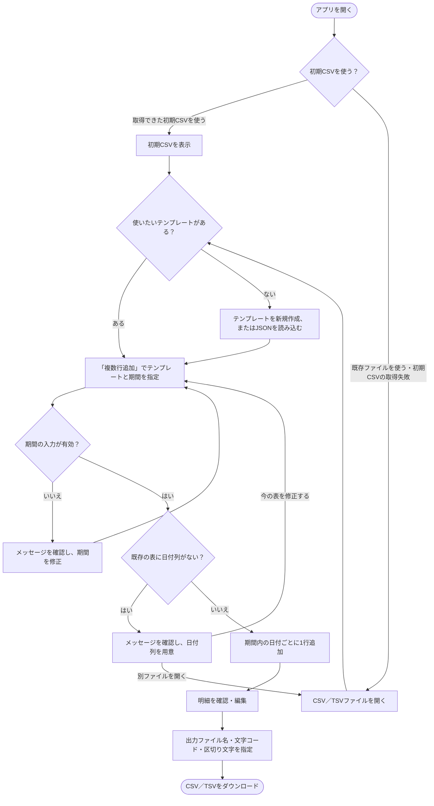

# CSVエディター 現行業務フロー

交通費精算用の明細を作成し、ファイルとしてダウンロードするまでの利用手順。利用者は交通費精算の明細を作成する人を想定する。

## 業務フロー図

## 主フロー

| 手順 | 利用者の操作 | 画面の応答 | 機能ID |
|---|---|---|---|
| 1. 表を開く | ブラウザでアプリを開く。既存の明細を編集する場合は「CSVを開く」からファイルを選ぶ。 | 起動時は交通費精算用の初期CSVを表示する。既存ファイルを選んだ場合は、その内容を編集欄に表示する。 | F01、F02 |
| 2. 明細の追加方法を選ぶ | 「複数行追加」を押し、行追加テンプレート、開始日、終了日を選ぶ。 | ダイアログを開く。開始日と終了日の初期値には当日が入る。 | F07 |
| 3. 明細を追加する | 入力内容を確認し、「追加する」を押す。 | 指定期間の日付ごとに1行を生成し、選択行の直後または末尾に追加する。列が見つからなかったテンプレート項目があれば、その項目を通知する。 | F07 |
| 4. 明細を確認・編集する | 日付、金額、備考などを確認し、必要なセルを修正する。必要に応じて検索、行・列追加、一括編集、元に戻す・やり直すを使う。 | 表を更新し、検索に一致したセルを強調する。 | F03〜F06、F10 |
| 5. ファイルを書き出す | 「エクスポート」を押し、ファイル名・文字コード・区切り文字を設定してダウンロードする。 | 列名と明細を選択形式で書き出し、画面下部に結果を表示する。 | F11 |

## 分岐

| 状況 | 現行の動作と再開位置 |
|---|---|
| 初期CSVを取得できない | ファイル選択、空の表の作成、サンプル表示から作業を始められる。テンプレートで精算明細を作る場合は `日付` 列があるファイルを開き、手順2へ進む。 |
| 使いたいテンプレートがない | 手順2の前に「テンプレート」で新規作成するか、保存済みのJSONを読み込む。JSONを読み込むと画面上のテンプレート一覧全体が置き換わる。 |
| 期間が空欄・逆順、または1,000日を超える | 明細の追加を中止し、画面にメッセージを表示する。手順2で期間を修正する。 |
| 既存の表に `日付` 列がない | 明細の追加を中止し、画面にメッセージを表示する。手順1で初期CSVの形式に合うファイルを開くか、列を整えてから手順2へ戻る。 |
| 作成・編集したテンプレートを次回も使いたい | テンプレート管理で現在の一覧をJSONに書き出す。次回の作業時にそのJSONを読み込む。 |

このフローの完了は、作成した明細ファイルのダウンロード。提出先での取り込みや承認手続きは、現行アプリの資料から確認できていない。

## 参照

- [機能一覧](01_機能一覧.md)
- [基本設計](03_基本設計.md)
- [現行アプリのREADME](../../../../csv-editor/csv_editor_app/README.md)
- [現行アプリのHTML](../../../../csv-editor/csv_editor_app/web_csv_editor.html)
