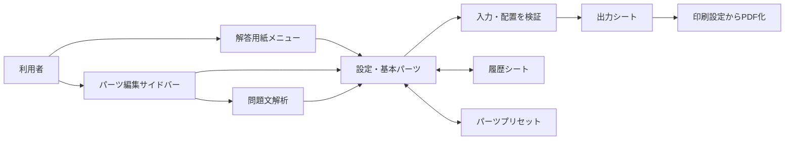

# 解答用紙GAS 基本設計

| 項目 | 内容 |
| --- | --- |
| 対象 | `create-answer-paper-gas` のスプレッドシート用Apps Script |
| 対象画面 | Googleスプレッドシートの「解答用紙」メニュー、設定シート、パーツ編集サイドバー |
| 設計の基準 | 2026-11-17 時点の `src/` の現行実装 |
| 想定読者 | 開発・保守担当者 |

## 1. 目的と対象範囲

定期考査の解答用紙を、Googleスプレッドシート上の設定から生成する。利用者は基本パーツ、大問、小問行を入力・編集し、B4横を想定した左右2領域の「出力」シートを作る。

本書はGAS側のシート作成、パーツ編集、問題文解析、履歴、プリセット、出力更新を対象とする。別リポジトリのNext.jsアプリとのデータ連携はない。GAS内にPDFファイルの自動生成・ダウンロード機能はなく、PDF化は利用者がスプレッドシートの印刷機能から行う。

## 2. システム構成と利用の流れ

Apps ScriptのV8ランタイムで動作する。`onOpen()` がスプレッドシートへ「解答用紙」メニューを追加する。サイドバーはHTML Serviceで表示し、`google.script.run` でGASの関数を呼び出す。設定・履歴・プリセット・生成結果は同じスプレッドシート内のシートに保持する。

基本的な利用順は、①「空の設定を作成」で入力表を用意する、②「基本パーツ」「設定」に使用行と内容を入力する、③必要に応じてサイドバーで編集・問題文解析・プリセット適用を行う、④「出力を更新」で生成結果を確認する、⑤スプレッドシートの印刷機能でPDF化する、である。

## 3. 画面設計

### 3.1 画面構成

| 領域 | 主な役割 |
| --- | --- |
| 「解答用紙」メニュー | 設定の初期化、出力更新、プリセット欄の整備と適用、サイドバー表示 |
| 「基本パーツ」シート | 考査見出し、年組氏名欄、得点枠の使用・順番・文字・寸法を入力 |
| 「設定」シート | 大問表と小問行表を入力。大問番号で親子を対応付ける |
| 「出力」シート | 検証済みのパーツをB4横想定の左右2領域に描画 |
| 「パーツプリセット」シート | 保存した基本パーツ・大問と、大問に属する小問行を保持 |
| パーツ編集サイドバー | 「パーツ編集」「問題文から追加」「設定の履歴」の3タブ |
| 履歴シート | 初期化・復元前の「設定」「基本パーツ」を複製して保持 |

サイドバーの「パーツ編集」には使用中のパーツが一覧表示され、順番、内容、寸法、小問行を変更できる。「問題文から追加」では解析候補の根拠や枠数を確認してから登録する。「設定の履歴」では保存済み設定をプレビューして復元する。

### 3.2 用紙・表示条件

| 項目 | 現行仕様 |
| --- | --- |
| 出力グリッド | 72列×51行。列幅・行高は各19px |
| 左右の配置領域 | 左は3列目、右は39列目から。各領域は33列幅、3行目から下へ配置 |
| 使用可能な高さ | 各領域49行。1つのパーツや大問は左右に分割しない |
| 基本パーツの入力枠 | 「基本パーツ」シートの4〜13行、最大10件 |
| 大問の入力枠 | 「設定」シートの21〜60行、最大40件 |
| 小問行の入力枠 | 「設定」シートの6〜155行、最大150件 |
| 出力の用紙想定 | B4横。実際の物理寸法はスプレッドシートの印刷設定に依存 |

パーツは「使用」にチェックがある行だけを対象とし、基本パーツと大問に共通の「順番」で並べる。同じ順番の場合は元のシート行に基づいて並べる。左上から積み上げ、次のパーツが左領域に収まらなければ右上へ送る。大問の見出しと小問行は一体として扱い、途中で分割しない。

## 4. 機能設計

| ID | 機能 | 入力・操作 | 結果 |
| --- | --- | --- | --- |
| G-01 | 空の設定を作成 | メニューから実行 | 既存の設定表がある場合は履歴へ複製した後、「設定」「基本パーツ」「出力」を初期化する |
| G-02 | 出力を更新 | メニューから実行 | 使用中の行と配置を検証し、「出力」を描画し直す |
| G-03 | パーツ編集 | サイドバーで使用中のパーツを選択し、設定を保存 | 対象行と必要な小問行を更新し、出力を再生成する |
| G-04 | パーツ操作 | 順番変更、複製、削除 | 設定表を更新し、出力を再生成する |
| G-05 | 問題文から追加 | 問題文を解析し、候補を確認・修正して登録 | 1件または複数の大問と小問行を設定へ追加・置換する |
| G-06 | 設定の履歴 | 履歴を選択・確認して復元 | 復元前の設定を履歴へ保存し、選択した内容を反映する |
| G-07 | パーツプリセット | 選択中のパーツを命名保存、対象行のH列で選んで適用 | 基本パーツまたは大問とその小問行の設定を再利用する |
| G-08 | 印刷用シート作成 | 出力更新後、利用者が印刷を設定 | 「出力」シートをB4横・1ページで印刷またはPDF化する |

### 4.1 大問・小問行と問題文解析

大問は番号、順番、観点、配点、幅、後の空き、および任意の題名を持つ。小問行は対象大問番号、行番号、左端の表示番号、ラベル、幅比、高さ、解答欄パターン、枠数などを持つ。パターンは「小問複合枠」または「記述欄」。未指定時はラベルの有無から決める。小問複合枠ではラベルごとの幅比で解答欄を分け、記述欄では指定した枠数へ等分する。

問題文解析は、行頭の「大問2」「【大問 2】」などを大問の境界とし、行頭の枝番や `(1)`、`問1` などを小問の境界として候補を作る。解答記号、連続記号、文章中の個数表現などから枠数を推定する。解析結果には判定根拠と「要確認」を表示し、利用者がラベル、枠数、幅比などを確認・修正できる。「要確認」の項目は確認チェックなしで登録できない。既存大問番号と衝突した場合は置換確認を求め、確認後に設定が変わっていれば登録を中止する。

### 4.2 編集・履歴・プリセット

サイドバーの一覧は使用中の基本パーツと大問を表示する。基本パーツは順番・表示文字・幅・高さ・後の空きを編集できる。大問は番号・題名・観点・配点・幅・後の空きと小問行をまとめて編集できる。複製時は次の順番を設定し、大問には重複しないコピー番号と小問行の複製を作る。削除時は使用をオフにし、大問に属する小問行を消す。

「空の設定を作成」と履歴復元では、実行前の設定を `設定_旧_...`、対応する基本パーツを `基本パーツ_旧_...` として保存する。履歴の復元対象が旧形式の場合はエラーにする。プリセットは専用シートに名前付きで保存し、設定行のH列で選択して適用する。大問のプリセットには小問行も含まれ、既存の小問行を置き換える際は確認を求める。

## 5. データと状態

| データ | 内容・保持場所 |
| --- | --- |
| 基本パーツ表 | 「基本パーツ」A:G列。使用、順番、種類、表示文字、幅、高さ、後の空き |
| 大問表 | 「設定」A:G列の21〜60行。使用、順番、番号、観点、配点、幅、後の空き。I列に題名 |
| 小問行表 | 「設定」J:U列の6〜155行。対象番号、行番号、ラベル、幅比、高さ、パターン、枠数、解析根拠など |
| プリセット | 「パーツプリセット」A:J列に親データ、L:W列に大問の小問行。IDで対応付ける |
| 履歴 | スプレッドシート内の `設定_旧_...` と、存在する場合の `基本パーツ_旧_...` |
| 出力 | 「出力」シートの結合セル、罫線、文字、印刷用グリッド |
| サイドバー状態 | 選択中のパーツ、編集中の小問行、問題文の解析候補をHTML側に一時保持 |

設定と生成結果はスプレッドシートに残る。履歴は初期化・復元の直前に作られ、通常の編集操作ごとには作られない。大問の題名、グループ経路、記入項目数、判定根拠など一部の項目は管理・照合用であり、現在の出力シートの文字や枠の描画には使われない。

## 6. 出力設計

| 出力 | 内容 | 特性 |
| --- | --- | --- |
| 「出力」シート | 基本パーツと大問・小問行を左右2領域へ配置 | セル結合、罫線、文字で構成。更新時は既存の出力シートを初期化して再描画する |
| B4横の印刷・PDF | 利用者が「出力」シートをB4・横向き・1ページで印刷 | GASはPDFファイルを自動作成しない。印刷結果はスプレッドシート側の設定に依存する |

出力前に入力値と配置を計算し、基本パーツまたは大問が左右の領域に収まらない場合は出力の更新を中止する。入力・配置検証が通ってから「出力」を消して再描画する。描画途中にエラーが起きた場合の旧出力シートへの自動復元は実装されていない。

## 7. 制約・既存資料との差異

| 区分 | 現行実装に基づく扱い |
| --- | --- |
| 別アプリとの連携 | Next.js側の解答用紙エディタやCSVプレビューとは独立している |
| PDF化 | GASの出力はスプレッドシート。「PDF出力」ボタンやDriveへのPDF保存処理はない |
| 用紙サイズ | 72列×51行のグリッドはB4横を想定するが、印刷時の物理サイズをGASだけでは保証しない |
| 履歴 | 初期化・復元前のスナップショットであり、すべての編集を記録する操作履歴ではない |
| 設定の上限 | 基本パーツ10件、大問40件、小問行150件の入力枠がある。追加時に空きがなければエラー |
| 更新の保護 | 問題文の一括登録、大問と小問の編集、履歴復元、プリセット操作にはロックや検証・設定の差し戻しがある。通常のパーツ操作全体が同一の方法で保護されるわけではない |
| 既存資料 | GASリポジトリには現行仕様をまとめた文書がないため、本書は `src/` の実装を基準とした。別リポジトリの技術仕様書はGASの仕様として扱わない |

上記は現状の記録であり、GASの機能変更を定めるものではない。

## 8. 参照資料・実装

- [メニュー・シート作成・出力生成](../../../create-answer-paper-gas/src/AnswerSheetGenerator.js) — 設定、検証、配置、描画、サイドバー連携
- [サイドバー](../../../create-answer-paper-gas/src/PartEditor.html) — 3タブの操作、解析結果の確認、GAS呼び出し
- [問題文解析](../../../create-answer-paper-gas/src/DocumentAnalysis.js) — 文書全体の解析と大問一括登録
- [履歴](../../../create-answer-paper-gas/src/History.js) — 設定履歴の一覧、プレビュー、復元
- [プリセット](../../../create-answer-paper-gas/src/Presets.js) — 保存、選択欄、適用
- [Apps Script設定](../../../create-answer-paper-gas/src/appsscript.json) — V8ランタイム、タイムゾーン
